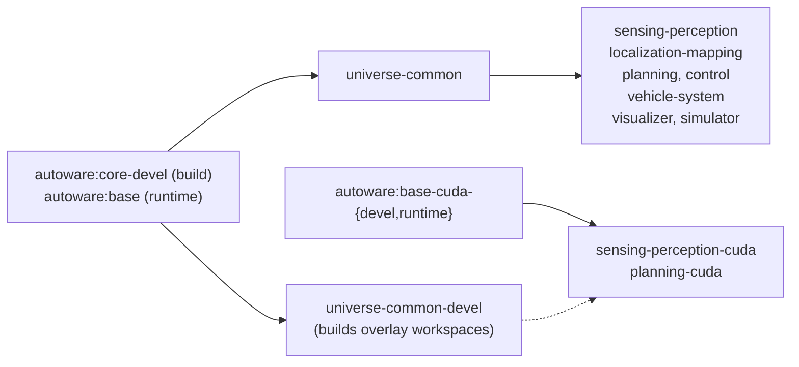

# Build from Source

How to build the Open AD Kit images locally and how CI builds them. Most users
do not need this: `openadkit run` pulls the published images (see
[Container Images](../releases/container-images.md)).

## Prerequisites

- Ubuntu 22.04 or 24.04 (`openadkit setup` supports Ubuntu only; elsewhere,
  install Docker with Buildx and Compose yourself)
- Git; step 3 installs the tools that import the Autoware sources
- Disk space for several multi-gigabyte images: `universe-common-devel` alone
  takes about 10 GB

The component Dockerfiles build on upstream Autoware images from GHCR and
compile their package sets from a local `autoware/src` tree (step 4 below).

## Build System

Images are built with [Docker Bake](https://docs.docker.com/build/bake/) from
[`components/docker-bake.hcl`](https://github.com/autowarefoundation/openadkit/blob/main/components/docker-bake.hcl),
the same file CI uses.



`universe-common` compiles the shared part of Autoware Universe on the upstream
`core-devel` image and copies the result onto the lean upstream `base` image, so
build tools never reach the runtime layers. Every component builds from it.
The CUDA variants, `sensing-perception-cuda` and `planning-cuda`, build on the
upstream CUDA images and copy in the Autoware tree of the devel image.

The published images end with a per-build Ubuntu security refresh. Components
compile on `universe-common-build`, the devel image without that refresh, which
CI pushes only to its build cache. Its digest changes only with its inputs, so a
build that changes no Autoware source or component Dockerfile reuses the cached
compiles and only refreshes and reassembles the runtime images.

| Group | Targets |
|-------|---------|
| `common` | `universe-common-devel`, `universe-common` |
| `component` | all component images, including the amd64-only `sensing-perception-cuda` and `planning-cuda` |
| `planning-simulation` | `universe-common` plus the images Planning Simulation needs (local builds) |
| `default` | `common` + `component` |

CI publishes every image to `{{ registry }}`.

## Build and Run Locally

```bash
# 1. Clone the repository
git clone https://github.com/autowarefoundation/openadkit.git
cd openadkit

# 2. Install host dependencies
./openadkit setup
```

--8<-- "includes/docker-group-activation.md"

```bash
# 3. Install the source import tools; pipx puts vcs in ~/.local/bin
sudo apt-get install -y pipx python3-yaml
pipx install vcs2l
export PATH="$HOME/.local/bin:$PATH"

# 4. Import the Autoware sources this branch pins
AUTOWARE_REF=$(cat .github/autoware.ref)
git init autoware
git -C autoware fetch --depth 1 \
  https://github.com/autowarefoundation/autoware.git "$AUTOWARE_REF"
git -C autoware checkout --detach FETCH_HEAD
# An Autoware release, built on its official images
python3 .github/scripts/export_autoware_lock.py \
  autoware/repositories/autoware.repos autoware.lock
export UPSTREAM_TAG="$AUTOWARE_REF"
mkdir -p autoware/src
vcs import --shallow autoware/src < autoware.lock
# Backported Autoware fixes, when the branch carries any
python3 .github/scripts/autoware_patches.py apply autoware/src
mkdir -p autoware/src/middleware/external
touch autoware/src/middleware/external/.keep

# 5. Build the shared universe-common layer (~2 hours)
docker buildx bake -f components/docker-bake.hcl common

# 6. Build the Planning Simulation images (~2 hours)
docker buildx bake -f components/docker-bake.hcl --load planning-simulation

# 7. Run with the local images
./openadkit run planning-simulation
```

- `--load` puts the images in the local Docker store; without it, Bake only
  fills the build cache.
- Local builds are tagged `<target>-<arch>-<ros-distro>` (for example
  `planning-amd64-humble`), which is the tag `./openadkit` looks up in a
  source checkout. The arch follows the build host; when cross-building, set tags
  with `--set <target>.tags=...`. A source checkout pulls none of these: `run`
  stops on a missing one and names the Bake command that builds it.
- For Jazzy, build with `ROS_DISTRO=jazzy` and run with `--ros-distro jazzy`.
- To build a [kit](../kits/create-a-kit.md)'s overlay workspace against these
  images, load the devel image too; `openadkit build` uses its local tag:

    ```bash
    docker buildx bake -f components/docker-bake.hcl --load universe-common-devel
    ```

### Run a CI Build's Images

To skip the local build, run the images of one CI build instead: every
component image and the devel image come from that build. The build summary of
`build-all-images` shows its build tag.

```bash
export OPENADKIT_BUILD={{ registry }}:<build tag>    # for example 123456789-1
./openadkit run planning-simulation
```

A single `*_IMAGE` setting in the host settings file still replaces one image.

Other useful targets:

```bash
docker buildx bake -f components/docker-bake.hcl                                # everything
docker buildx bake -f components/docker-bake.hcl component                      # all components
docker buildx bake -f components/docker-bake.hcl --load sensing-perception      # one image
```

### Build Variables

| Variable | Description | Default |
|----------|-------------|---------|
| `ROS_DISTRO` | `humble` or `jazzy` | `humble` |
| `UPSTREAM_TAG` | Upstream Autoware release to build on, the tag in `.github/autoware.ref` (e.g. `2.0.0`); required | `""` |
| `UPSTREAM_REPO` | Upstream Autoware image repository | `ghcr.io/autowarefoundation/autoware` |
| `ROS_SNAPSHOT_HUMBLE`, `ROS_SNAPSHOT_JAZZY` | ROS apt snapshot the `UPSTREAM_TAG` images were built from. The build fails when they do not match; see [ROS snapshot](https://github.com/autowarefoundation/openadkit/blob/main/components/shared/ros-snapshot/README.md). | Snapshots for `2.0.0` |

## Continuous Integration

[`build-all-images.yaml`](https://github.com/autowarefoundation/openadkit/blob/main/.github/workflows/build-all-images.yaml)
builds every target with the same Bake file. The build matrix comes from
[`.github/image-inventory.json`](https://github.com/autowarefoundation/openadkit/blob/main/.github/image-inventory.json),
the source of truth for which images are built and for which architectures.

Jobs run in dependency order: `prepare`, then `build-common`, then
`build-components`. Most images build for Humble and Jazzy on amd64 and arm64.
`create-manifests` then combines the per-arch images into multi-arch tags. CI
disables the local tags (`LOCAL_IMAGE=""`) and tags images through
`docker/metadata-action`.

[`.github/autoware.ref`](https://github.com/autowarefoundation/openadkit/blob/main/.github/autoware.ref)
pins the Autoware release a branch builds on its official images. CI builds
`main` and `release/*` pushes, keeps registry caches per branch, and scans and
runs the evidence cells after each build. A weekly scan of `main`'s latest build
reports its findings in the repository's Security tab; a failed run shows in
Actions.

### Testing a Pull Request

A pull request that changes an image's inputs builds the affected images, amd64
only, for both distros. A pull request from this repository pushes them to the
CI package `openadkit-ci`, completes the build there with its base branch's
other images, copied by digest, and runs the amd64
[evidence cells](../releases/evidence.md#cells-and-levels) on that build before
merge. A fork's pull request cannot push: its images stop at the build and scan,
and run in the cells after merge.

A change that rebuilds no image, such as a deployment setting, the CLI or a
check, runs the cells against its base branch's latest successful build. A
dispatch of `evidence.yaml` with `source_ref` tests another branch or commit.
The cells take the deployments, CLI and checks from the tested commit and the
images from the build. A pull request's run is never release evidence.

Releases promote one of these builds; see the [Release Process](release-process.md).
